# Medora — Entity-Relationship (ER) Diagram

## 1. Overview
This document specifies the complete Entity-Relationship diagram for the Medora database architecture, exactly matching the draft [prisma/schema.prisma](file:///c:/Users/Darshan/Downloads/Dicken%20JSD-I/Projects/Medora/prisma/schema.prisma).

---

## 2. Mermaid Entity-Relationship Diagram

```mermaid
erDiagram
    %% =========================================================================
    %% IDENTITY & AUTHENTICATION
    %% =========================================================================
    User ||--o| DoctorProfile : "1:1 profile"
    User ||--o| Patient : "1:1 profile (optional)"
    User ||--o{ RefreshToken : "1:N sessions"
    User ||--o{ Notification : "1:N recipient"
    User ||--o{ AuditLog : "1:N actor"
    User ||--o{ MedicalDocument : "1:N uploader"
    User ||--o{ Payment : "1:N collector"
    User ||--o{ QueueToken : "1:N urgency assigner"

    User {
        uuid id PK
        varchar email UK
        varchar password_hash
        enum role "PATIENT | DOCTOR | RECEPTIONIST | HOSPITAL_ADMIN"
        enum status "ACTIVE | INACTIVE | SUSPENDED"
        int failed_login_attempts
        timestamptz locked_until
        timestamptz token_invalid_before
        timestamptz created_at
        timestamptz updated_at
    }

    RefreshToken {
        uuid id PK
        uuid user_id FK
        varchar token_hash
        varchar device_info
        boolean is_revoked
        timestamptz expires_at
        timestamptz created_at
    }

    MRNSequence {
        int year PK
        int current_value
        timestamptz updated_at
    }

    %% =========================================================================
    %% HOSPITAL FACILITIES & DOCTOR PROFILES
    %% =========================================================================
    DoctorProfile ||--|{ DoctorDepartment : "1:N junctions"
    Department ||--|{ DoctorDepartment : "1:N junctions"
    DoctorProfile ||--o{ DoctorSchedule : "1:N recurring slots"
    DoctorProfile ||--o{ DoctorLeave : "1:N leave intervals"

    Department {
        uuid id PK
        varchar name UK
        varchar code UK
        text description
        text_array room_numbers
        boolean is_active
        timestamptz deleted_at
        timestamptz created_at
        timestamptz updated_at
    }

    DoctorProfile {
        uuid id PK
        uuid user_id FK,UK
        varchar license_number UK
        varchar specialization
        varchar qualifications
        decimal consultation_fee
        int default_slot_minutes
        varchar room_number
        text bio
        timestamptz created_at
        timestamptz updated_at
    }

    DoctorDepartment {
        uuid id PK
        uuid doctor_id FK
        uuid department_id FK
        boolean is_primary
        timestamptz created_at
    }

    DoctorSchedule {
        uuid id PK
        uuid doctor_id FK
        int day_of_week
        varchar start_time
        varchar end_time
        boolean is_active
        timestamptz created_at
        timestamptz updated_at
    }

    DoctorLeave {
        uuid id PK
        uuid doctor_id FK
        date start_date
        date end_date
        text reason
        timestamptz created_at
        timestamptz updated_at
    }

    %% =========================================================================
    %% PATIENTS & CLINICAL ONBOARDING
    %% =========================================================================
    Patient ||--o{ Appointment : "1:N bookings"
    Patient ||--o{ QueueToken : "1:N tokens"
    Patient ||--o{ Consultation : "1:N consultations"
    Patient ||--o{ Prescription : "1:N prescriptions"
    Patient ||--o{ DietPlan : "1:N diet plans"
    Patient ||--o{ MedicalDocument : "1:N files"
    Patient ||--o{ FollowUp : "1:N reviews"
    Patient ||--o{ Invoice : "1:N billing"

    Patient {
        uuid id PK
        uuid user_id FK,UK
        varchar mrn UK "MED-YYYY-XXXXX"
        varchar first_name
        varchar last_name
        date dob
        enum gender "MALE | FEMALE | OTHER"
        varchar phone
        varchar email
        text address
        enum blood_group
        text_array allergies
        text_array existing_conditions
        varchar emergency_contact_name
        varchar emergency_contact_phone
        timestamptz deleted_at
        timestamptz created_at
        timestamptz updated_at
    }

    %% =========================================================================
    %% APPOINTMENTS & QUEUES
    %% =========================================================================
    DoctorProfile ||--o{ Appointment : "1:N doctor slots"
    Department ||--o{ Appointment : "1:N dept slots"
    Appointment ||--o| QueueToken : "1:1 check-in token"
    Appointment ||--o| Consultation : "1:1 clinical encounter"
    Appointment ||--o| Invoice : "1:1 billing invoice"

    Department ||--o{ QueueToken : "1:N tokens"
    DoctorProfile ||--o{ QueueToken : "1:N assigned queue"
    QueueToken ||--o| Consultation : "1:1 walk-in encounter"

    Appointment {
        uuid id PK
        uuid patient_id FK
        uuid doctor_id FK
        uuid department_id FK
        timestamptz slot_start
        timestamptz slot_end
        enum status "SCHEDULED | CHECKED_IN | IN_CONSULTATION | COMPLETED | CANCELLED | NO_SHOW"
        text cancellation_reason
        timestamptz created_at
        timestamptz updated_at
    }

    QueueToken {
        uuid id PK
        varchar token_number
        date token_date
        uuid department_id FK
        uuid doctor_id FK
        uuid patient_id FK
        uuid appointment_id FK,UK
        enum urgency_level "STANDARD | URGENT | EMERGENCY"
        text urgency_reason
        uuid urgency_assigned_by_id FK
        enum status "WAITING | CALLED | ENGAGED | SERVED | MISSED | CANCELLED"
        int call_count
        timestamptz called_at
        timestamptz served_at
        timestamptz created_at
        timestamptz updated_at
    }

    %% =========================================================================
    %% CLINICAL ENCOUNTERS & MEDICAL RECORDS
    %% =========================================================================
    DoctorProfile ||--o{ Consultation : "1:N doctor consultations"
    Department ||--o{ Consultation : "1:N dept consultations"
    Consultation ||--o{ Diagnosis : "1:N diagnoses"
    Consultation ||--o| Prescription : "1:1 prescription"
    Consultation ||--o| DietPlan : "1:1 diet plan"
    Consultation ||--o{ ConsultationAddendum : "1:N signed addenda"
    Consultation ||--o{ MedicalDocument : "1:N attachments"
    Consultation ||--o{ FollowUp : "1:N follow-ups"

    DoctorProfile ||--o{ ConsultationAddendum : "1:N signed addenda"
    DoctorProfile ||--o{ Prescription : "1:N doctor prescriptions"
    DoctorProfile ||--o{ DietPlan : "1:N doctor diet plans"
    DoctorProfile ||--o{ FollowUp : "1:N doctor reviews"

    Consultation {
        uuid id PK
        uuid appointment_id FK,UK
        uuid queue_token_id FK,UK
        uuid patient_id FK
        uuid doctor_id FK
        uuid department_id FK
        enum status "IN_PROGRESS | FINALIZED"
        int version
        json vitals
        text chief_complaints
        text examination_notes
        text clinical_remarks
        timestamptz started_at
        timestamptz finalized_at
        varchar signature_hash
        timestamptz created_at
        timestamptz updated_at
    }

    Diagnosis {
        uuid id PK
        uuid consultation_id FK
        enum type "PROVISIONAL | FINAL"
        varchar icd_code
        text description
        text notes
        timestamptz created_at
        timestamptz updated_at
    }

    ConsultationAddendum {
        uuid id PK
        uuid consultation_id FK
        uuid doctor_id FK
        text reason "Mandatory clinical justification"
        text notes
        timestamptz created_at
    }

    Prescription ||--|{ PrescriptionItem : "1:N ordered medications"
    PrescriptionItem ||--o| PrescriptionItem : "replaces/supersedes"

    Prescription {
        uuid id PK
        uuid consultation_id FK,UK
        uuid doctor_id FK
        uuid patient_id FK
        text general_advice
        enum status "DRAFT | ISSUED"
        timestamptz created_at
        timestamptz updated_at
    }

    PrescriptionItem {
        uuid id PK
        uuid prescription_id FK
        varchar brand_name
        varchar generic_name
        varchar active_ingredient
        varchar strength
        enum dosage_form
        varchar dose_instructions
        varchar frequency
        int duration_days
        enum food_relation
        text doctor_instructions
        enum status "ACTIVE | DISCONTINUED"
        text discontinuation_reason
        timestamptz discontinued_at
        uuid superseded_by_item_id FK
        timestamptz created_at
        timestamptz updated_at
    }

    DietPlan ||--|{ DietMealItem : "1:N meal recommendations"

    DietPlan {
        uuid id PK
        uuid consultation_id FK,UK
        uuid doctor_id FK
        uuid patient_id FK
        int caloric_target_kcal
        decimal water_intake_litres
        text special_instructions
        text_array foods_to_avoid
        timestamptz created_at
        timestamptz updated_at
    }

    DietMealItem {
        uuid id PK
        uuid diet_plan_id FK
        enum meal_type "BREAKFAST | MID_MORNING | LUNCH | EVENING_SNACK | DINNER"
        text recommended_items
        varchar portion_size
        timestamptz created_at
        timestamptz updated_at
    }

    MedicalDocument {
        uuid id PK
        uuid patient_id FK
        uuid consultation_id FK
        enum document_type
        varchar file_name
        varchar file_path
        varchar mime_type
        bigint file_size_bytes
        varchar checksum_sha256
        uuid uploaded_by_user_id FK
        timestamptz created_at
        timestamptz updated_at
    }

    FollowUp {
        uuid id PK
        uuid consultation_id FK
        uuid patient_id FK
        uuid doctor_id FK
        date recommended_date
        text notes
        enum status "PENDING | SCHEDULED | COMPLETED | OVERDUE"
        timestamptz created_at
        timestamptz updated_at
    }

    %% =========================================================================
    %% BILLING & FINANCIAL OPERATIONS
    %% =========================================================================
    Invoice ||--|{ InvoiceItem : "1:N itemized lines"
    Invoice ||--o{ Payment : "1:N payment tenders"

    Invoice {
        uuid id PK
        varchar invoice_number UK
        uuid patient_id FK
        uuid appointment_id FK,UK
        decimal total_amount
        decimal discount_amount
        decimal net_amount
        enum status "UNPAID | PARTIALLY_PAID | PAID | REFUNDED"
        timestamptz created_at
        timestamptz updated_at
    }

    InvoiceItem {
        uuid id PK
        uuid invoice_id FK
        enum item_type "CONSULTATION | PROCEDURE | MEDICATION | ROOM_CHARGE"
        varchar description
        int quantity
        decimal unit_price
        decimal total_price
        timestamptz created_at
    }

    Payment {
        uuid id PK
        uuid invoice_id FK
        decimal amount
        enum payment_method "CASH | CARD | UPI | INSURANCE"
        varchar transaction_ref
        uuid received_by_user_id FK
        varchar receipt_number UK
        timestamptz paid_at
        timestamptz created_at
    }

    %% =========================================================================
    %% SUPPORTING AUDIT & NOTIFICATION RECORDS
    %% =========================================================================
    Notification {
        uuid id PK
        uuid user_id FK
        varchar title
        text message
        enum type
        boolean is_read
        timestamptz read_at
        timestamptz created_at
    }

    AuditLog {
        uuid id PK
        uuid actor_user_id FK
        varchar actor_role
        varchar ip_address
        varchar user_agent
        varchar action
        varchar entity_name
        varchar entity_id
        json payload_summary
        varchar previous_hash
        varchar record_hash
        timestamptz created_at
    }
```

---

## 3. Structural Alignment Verification
- **Cardinality Agreement**: Every 1:1, 1:N, and N:M relationship in the Mermaid diagram corresponds exactly to relation fields and foreign keys defined in `prisma/schema.prisma`.
- **Enum Conformance**: Enums use exact matching identifiers (e.g., `Role` is restricted to `PATIENT`, `DOCTOR`, `RECEPTIONIST`, and `HOSPITAL_ADMIN`).
- **Junction Entity**: `DoctorDepartment` models the M:N relationship between `DoctorProfile` and `Department` with `isPrimary` metadata and unique constraint `[doctorId, departmentId]`.
- **Self-Referential Relation**: `PrescriptionItem` includes self-referencing foreign key `superseded_by_item_id` to model replacement medication orders.
